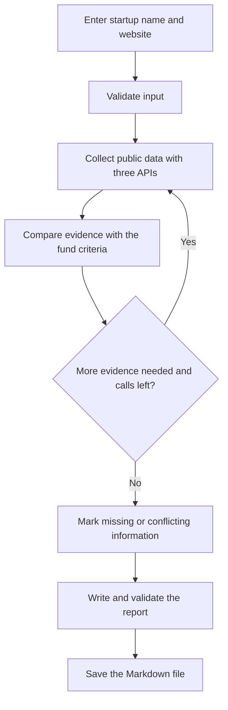

# VC Startup Screening Agent

## Use case

This project helps an investment analyst or associate at a venture capital fund review B2B startups at the Pre-Seed and Seed stages. The analyst enters a startup name and website. The agent gathers public information and saves a Markdown report to help the analyst decide whether to invite the startup to a first meeting.

The report checks the startup against the investment criteria of Puente Ventures, a fictional fund. The analyst makes the final decision.

## Why LangGraph

I chose LangGraph because startup screening requires me to keep track of findings, sources, conflicting information, and missing data. LangGraph keeps the sources, evidence, and assessment results available across the workflow. Python helps me check that each assessment has supporting evidence or is marked as Not verified. I considered n8n for its visual workflow, and I chose LangGraph to keep the MVP small and manage the research state in Python.

## API tests

| API | Purpose | Observed result |
|---|---|---|
| Tavily Search | Find public sources about startups and competitors. | HTTP 200 and three links with general Legaltech context. Later workflow runs found five sources each for Kalipso and Lawra. |
| Jina Reader | Extract readable text from public pages. | HTTP 200 and readable text about digital signatures and contract management from a company website. |
| GDELT DOC API | Find recent news about the startup or its sector. | HTTP 200 and five articles in JSON. Some titles were relevant to Legaltech. Earlier attempts returned HTTP 429. |

I first tested these APIs separately. Later, the complete workflow generated reports for Kalipso and Lawra. When GDELT returned HTTP 429 after one retry, the workflow still saved the report and marked recent news as Not verified.

## Report template

1. **Executive summary** — What the startup does and whether a first meeting is recommended.
2. **Business model and product** — What it sells, who buys it, and what process it automates.
3. **Fit with the fund's criteria** — Criterion, status, evidence, and source. The possible statuses are Meets, Does not meet, and Not verified.
4. **Technology and founders** — Public information that can be verified.
5. **Competitors and recent news** — Relevant findings with links and dates.
6. **Warning signs and open questions** — Supported concerns and information the analyst still needs.
7. **Sources** — Links connected to the findings they support.

## Initial workflow sketch


## Implemented workflow

1. Enter the startup name and official website.
2. Collect public information with Tavily Search, Jina Reader, and GDELT.
3. Load the fund rules from the local investment thesis.
4. Use GPT-4o mini to extract evidence for geography and funding stage. Python checks the quotes and applies the rules.
5. Save a Markdown report with sources. Mark criteria that need more review as `Not verified`.

If GDELT returns HTTP 429, the workflow retries once. If the retry fails, it saves the report with the available sources.

## Grounding and graph check

The project looks up investment rules by ID in
`knowledge/investment_thesis.json`. This gives the graph a clear rule
and a source reference for each lookup.

- `python retrieval.py geography` returned the rule and its source reference.
- `python retrieval.py revenue` reported that the criterion was unknown.
- `python main.py` ran all four steps in order. The assessment step received
  the geography rule and its source from the previous step.

## First automated screening report

I ran `python main.py` for Kalipso. The workflow collected public
sources and saved the first draft to `reports/kalipso-screening.md`.
The report cites the company website and marks missing information
as “Not verified”. Automatic assessment against the fund’s criteria
was still pending at that point.

### Geography check

The geography rule returned `Meets` for Kalipso. Spain is on the fund's
list of eligible headquarters countries. For this test, I manually
identified Spain from the [company announcement](https://kalipso.ai/blog/weve-raised-3-2m).
Automatic extraction was still pending at that point.

### Automated geography check and error handling

The workflow found evidence that Kalipso is based in Spain and marked
the geography criterion as `Meets`. The report includes the quote and
its source.

GDELT returned HTTP 429 after one retry. The workflow still saved the
report and marked recent news as `Not verified`.

## Funding-stage conflict test. 

I tested the extractor with two saved source snippets. It found both labels, Seed and Series A, and validated both quotes. The assessment returned Not verified because the sources gave different labels.

## Funding-stage validation 
- In a controlled test, the workflow accepted a quote that says Kalipso secured Seed funding. The funding-stage result was `Meets`.
- In a controlled test for Lawra, the workflow excluded an open Seed round, a future Series A milestone, and a funding round from another company. The funding-stage result was `Not verified`.
- Both saved reports show `Not verified` for funding stage. Neither report includes a funding-stage quote.

## Future go-to-market sprints

1. **Pilot the report with one VC team**
2. **Reach three more VC teams through accelerator referrals**
[Read the full go-to-market sprint plan](gtm_future_sprints.md)

## Local setup

1. Open the project folder with Python 3.11 active.
2. Install the dependencies.

   ```bash
   python -m pip install langgraph openai pydantic python-dotenv
   ```

3. For a new setup, copy `.env.example` to `.env`. If you already have a `.env`, use your existing file.

   ```bash
   cp .env.example .env
   ```

4. Set `TAVILY_API_KEY`, `OPENAI_API_KEY`, and `OPENAI_MODEL=gpt-4o-mini` in `.env`. Jina Reader and GDELT use public access. Keep your API keys in your local `.env`.

## File map

| File or folder | What it does |
|---|---|
| `main.py` | Starts and runs the LangGraph workflow. |
| `tavily_search.py`, `jina_reader.py`, `gdelt_news.py` | Search the web, read pages, and look for news. |
| `retrieval.py`, `knowledge/investment_thesis.json` | Store and look up the fund rules. |
| `headquarters_extractor.py`, `assessment.py` | Extract evidence, check quotes, and apply the rules. |
| `report_writer.py`, `reports/` | Build and store the Markdown reports. |
| `.env.example` | Lists the environment variables. |
| `gtm_future_sprints.md` | Describes the pilot and how to reach more VC teams. |

## How to run

From the project folder, run the workflow with the startup name and its official website:

```bash
python main.py "Kalipso" "https://kalipso.ai/"
python main.py "Lawra" "https://lawra.io/"
```

The workflow saves a separate report for each startup:

- [Kalipso screening report](reports/kalipso-screening.md)
- [Lawra screening report](reports/lawra-screening.md)

## Presentation and demo

- [View the presentation slides (PDF)](presentation/SO_project3.pdf)
- [Watch the demo recording](https://drive.google.com/file/d/1Ah5iBXRJtACox6QuJvRH1--m26oTsr_1/view?usp=drive_link)