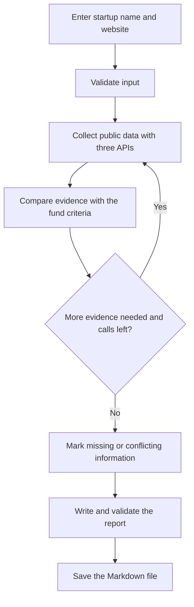

# VC Startup Screening Agent

## Use case

This project helps an investment analyst or associate at a venture capital fund review B2B startups at the Pre-Seed and Seed stages. The analyst enters a startup name and website. The agent gathers public information and saves a Markdown report to help the analyst decide whether to invite the startup to a first meeting.

The report checks the startup against the investment criteria of Puente Ventures, a fictional fund. The analyst makes the final decision.

## Why LangGraph

I chose LangGraph because startup screening requires me to keep track of findings, sources, conflicting information, and missing data. Its shared state and conditional routes help me control when the agent searches again and when it stops. Python helps me validate the report structure and check that each assessment has supporting evidence or is marked as not verified. I considered n8n for its visual workflow, but I chose one stack to keep the MVP small and manage the research state in Python.

## API tests

| API | Purpose | Observed result |
|---|---|---|
| Tavily Search | Find public sources about startups and competitors. | HTTP 200 and three links with general Legaltech context. A search for a specific startup is still pending. |
| Jina Reader | Extract readable text from public pages. | HTTP 200 and readable text about digital signatures and contract management from a company website. |
| GDELT DOC API | Find recent news about the startup or its sector. | HTTP 200 and five articles in JSON. Some titles were relevant to Legaltech. Earlier attempts returned HTTP 429. |

These tests ran separately. The complete workflow still needs to be implemented and tested. If GDELT remains rate-limited after one retry, the report can use the available sources and mark the news section as not verified.

## Report template

1. **Executive summary** — What the startup does and whether a first meeting is recommended.
2. **Business model and product** — What it sells, who buys it, and what process it automates.
3. **Fit with the fund's criteria** — Criterion, status, evidence, and source. The possible statuses are Meets, Does not meet, and Not verified.
4. **Technology and founders** — Public information that can be verified.
5. **Competitors and recent news** — Relevant findings with links and dates.
6. **Warning signs and open questions** — Supported concerns and information the analyst still needs.
7. **Sources** — Links connected to the findings they support.

## Workflow sketch

The fund's criteria guide the assessment. The method for retrieving supporting context is still to be decided.

## Future go-to-market sprints

1. **Pilot the report with one VC team**
2. **Reach three more VC teams through accelerator referrals**

## Local setup

- Work in the `project3-vc-screening` folder with Python 3.11.
- Copy `.env.example` to `.env` and add your Tavily key to `TAVILY_API_KEY`.
- The Jina Reader and GDELT tests used public access without API keys.
- Keep `.env` local. Git ignores it. The `.env.example` file contains variable names with empty values.